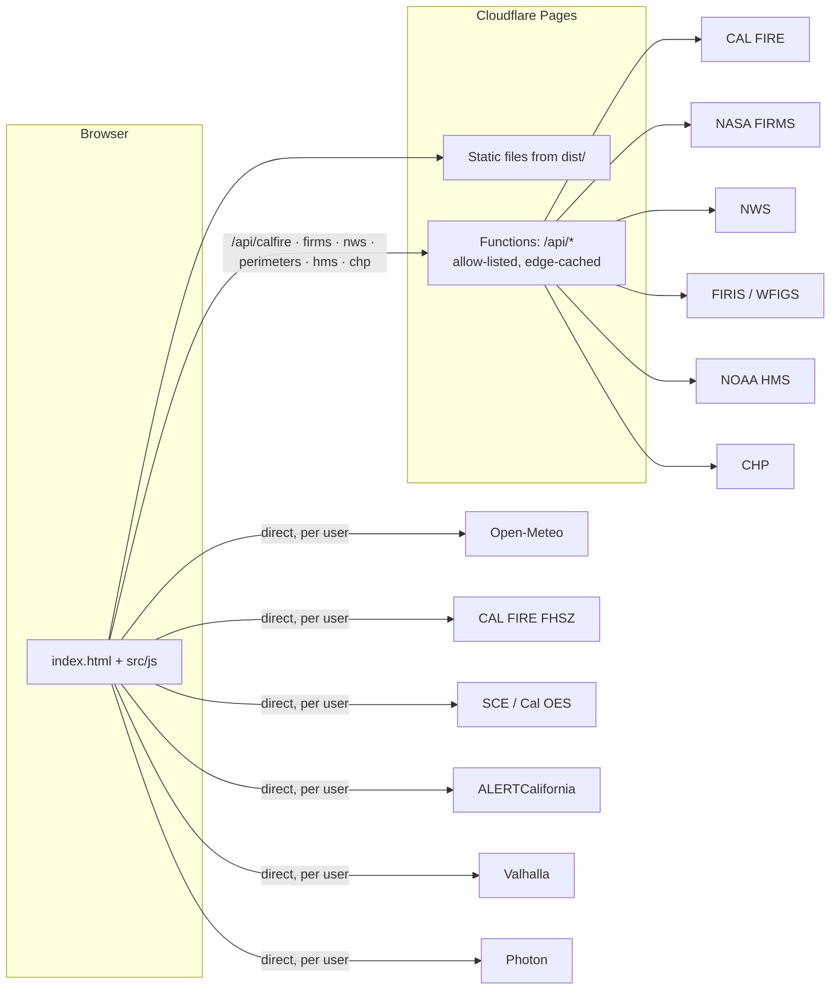
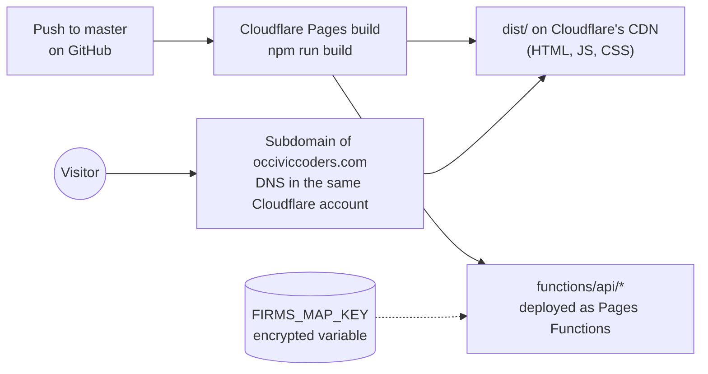

# California Fire Watch

A live wildfire map for California, operated by Initial Apps LLC and built with
[OC Civic Coders](https://www.occiviccoders.com/). It pulls
together public data that normally lives on a dozen different sites (CAL FIRE incidents, fire
perimeters, NASA satellite hotspots, Red Flag Warnings, wind, smoke, air quality, power shutoffs, road
closures, fire cameras) and puts it on one map, with tools to plan a way out and get a home ready.

It's a static site plus a handful of small serverless proxies, hosted for free on **Cloudflare Pages**.
The [Hosting](#hosting) section walks through exactly how, and how to run it somewhere else.

> **Disclaimer.** California Fire Watch is an unofficial volunteer project. It is information only,
> provided “as is” with no warranty, and it is only as accurate as the third-party data it shows, which
> can be late, incomplete, or wrong. Never use it to decide whether, when, or how to evacuate; official
> orders and alerts always take priority. Initial Apps LLC, OC Civic Coders, and their contributors accept
> no liability for its use.
> The full text is shown in the app on first visit (`index.html`, `#about`).

**Contents:** [What it does](#what-it-does) · [Quick start](#quick-start) · [How it's built](#how-its-built) ·
[Project layout](#project-layout) · [Feature walkthroughs](#feature-walkthroughs) ·
[Data sources & API usage](#data-sources--api-usage) · [Hosting](#hosting) ·
[Working on the code](#working-on-the-code) · [Credits & license](#credits--license)

---

## What it does

| Feature | What you see |
|---|---|
| **Fires** | CAL FIRE incidents as callout cards (size, containment meter, wind at the fire), mapped perimeters with a glowing active edge, and earlier perimeters as growth rings. |
| **Satellite heat** | NASA FIRMS detections from the last 24 h. Heat that isn't near any known fire is flagged as a *possible new fire*; heat that shows up every day (refineries, power plants) is labeled *persistent*. |
| **Fire weather** | NWS Red Flag Warnings and Fire Weather Watches, an animated statewide wind field, wind arrows, a Hot-Dry-Windy index layer, and a 72-hour timeline to scrub through the forecast. |
| **Forecast panel** | 72-hour wind/humidity chart and air quality for Orange County and the state's known fire-wind corridors (Santa Ana, Sundowner, Diablo, North wind). |
| **Context layers** | Smoke plumes (NOAA), Fire Hazard Severity Zones (CAL FIRE), and power shutoffs/outages (SCE, Cal OES). |
| **Fire cameras** | Each fire's card links the nearest ALERTCalifornia cameras, the ones pointed at it first. |
| **Evacuation route planner** | Pick a start point; it fetches real driving routes in eight directions, scores them against fire perimeters, downwind spread zones, and CHP-reported closures/crashes, and shows the best three with an "Open in Google Maps" link. |
| **Get ready** | Check any address (hazard zone, nearest fire, warnings, wind, air quality, power), plus saved checklists for defensible space, home hardening, a go-bag, leaving, and Red Flag days. |
| **Phones** | Map on top, sidebar below, details and tools in bottom sheets. |

---

## Quick start

Requires Node 20.19+ or 22.12+ (Vite 8).

```bash
npm install
cp .env.example .env.local   # then paste a free NASA FIRMS map key into it
npm run dev                  # http://localhost:5173
```

Get a FIRMS key at <https://firms.modaps.eosdis.nasa.gov/api/map_key/>. Without one the app still works;
the satellite hotspot layer is just disabled.

| Command | What it does |
|---|---|
| `npm run dev` | Dev server with hot reload and the API proxies. |
| `npm run build` | Production bundle in `dist/`. |
| `npm run preview` | Serves `dist/` locally, with the same proxies. |
| `npx wrangler pages dev dist` | Serves `dist/` with the **production** Cloudflare Functions instead of the Vite proxies (reads the key from `.dev.vars`). |

Opening `index.html` directly from disk won't work; several sources must go through `/api/*`.

---

## How it's built

No framework: plain ES modules, [MapLibre GL JS](https://maplibre.org/) for the map, Sass for styles,
[Vite](https://vite.dev/) to bundle. In production it's a static site on Cloudflare Pages plus a few
small Pages Functions that act as caching proxies.



**Why some sources are proxied and some aren't.** A source goes through `/api/*` if (a) it doesn't allow
browser requests (no CORS headers: CAL FIRE, FIRMS, CHP, NOAA HMS), (b) it needs a secret (FIRMS key),
or (c) every visitor asks for the exact same data, so one cached copy can serve everyone (NWS alerts,
fire perimeters). Sources that differ per user or per map view (your address, your route, the zones in
your viewport) go direct from the browser.

### The page lifecycle (`src/js/main.js`)

`main.js` is the orchestrator. It owns a single `state` object and wires every module together:

1. **Startup:** shows the disclaimer if it hasn't been accepted, creates the map, and on `load` adds all
   layers (`layers.js`), the incident markers, wind particles, the HDW layer, the planner, and the
   readiness drawer.
2. **`refresh()`** runs every 5 minutes (only while the tab is visible) and on the ↻ button. It loads
   incidents, perimeters, hotspots, hotspot history, and fire weather in parallel with
   `Promise.allSettled`, so one failing source never blocks the others. Each result is pushed into a
   MapLibre GeoJSON source with `setData`, then the sidebar re-renders. Overlapping calls share one run.
3. **`refreshWind()`** runs every 3 hours. The statewide grid is about 500 points, so it's cached in
   `localStorage` and reused across reloads.
4. **Interaction:** a single map `click` handler checks the planner and readiness tools first, then
   walks a priority list of clickable layers (heat, hotspots, power, perimeters, warnings, smoke, hazard
   zones) and opens the matching popup.

### Layers and draw order

Everything visible on the map is a MapLibre layer except two things: incident callouts are DOM markers
(`incidentMarkers.js`) and wind streaks are a `<canvas>` over the map (`wind/particles.js`). Layer order is
set in `layers.js` with `beforeId`, from bottom to top: basemap → hazard zones / power / smoke → fire
weather zones → HDW shading → perimeters and growth rings → hotspots → possible-new-fire rings → labels.
Toggle groups in the sidebar map to `LAYER_GROUPS`.

### Popups vs. bottom sheets (`mapCard.js`)

`createMapCard()` returns an object with the same methods as `maplibregl.Popup` (`setLngLat`, `setHTML`,
`addTo`, `remove`, `isOpen`). On wide screens it is a normal popup; below 900 px it renders the same HTML
into a bottom sheet and pans the map so the tapped point stays visible. Callers don't know the
difference.

### Styling

`src/sass/ocfire.scss` pulls in `abstracts/` (colors, the `respond()` breakpoint mixin) and one partial
per area of the UI. Breakpoints: `tab-port` (≤ 900 px) stacks the map over the sidebar and turns drawers
into bottom sheets; `phone` (≤ 600 px) tightens spacing. Overlays use `$z-overlay` so they sit above
incident markers but below popups.

---

## Project layout

```
index.html                  Page shell: sidebar, map, drawers, bottom sheet, disclaimer dialog
vite.config.js              Dev/preview proxies for /api/* (mirror of functions/)
wrangler.toml               Cloudflare Pages config (build output = dist)
functions/api/              Cloudflare Pages Functions (production proxies), one file per source
server/proxy.js             Shared proxy: GET only, edge cache, User-Agent, error handling
scripts/build-baseline.mjs  Rebuilds public/hotspot-baseline.json (one year of satellite heat per ~1 km cell)
public/                     Static files copied as-is into the build (the hotspot baseline)
workers/collector/          Scheduled Worker + D1 schema that logs hotspot tracks for model research
src/js/
  main.js                   Orchestrator: state, refresh loops, map setup, click handling
  config.js                 Map defaults, bounding boxes, wind grid, forecast corridors
  layers.js                 All MapLibre sources/layers, colors, toggle groups, animations
  incidentMarkers.js        CAL FIRE callout cards (DOM markers) with containment meters
  popups.js                 HTML for every popup / sheet
  explain.js                Plain-language summaries ("about 2× Disneyland", containment stages)
  sidebar.js                Stats, incident list, status line, Red Flag banner
  mapCard.js                Popup on desktop, bottom sheet on phones
  about.js                  Disclaimer + credits dialog (first-visit acceptance)
  earlyDetection.js         Clusters unexplained satellite heat into possible new fires and scores them
  geo.js / util.js          Point-in-polygon, distances, formatting, fetchJSON, cached()
  sources/                  One module per data feed; each returns GeoJSON or plain data
  wind/                     Wind particles, arrows, HDW layer, timeline, forecast panel, fire-weather math
  evac/                     Route planner: routing, hazards, scoring, geometry, UI
  ready/                    "Get ready" drawer and checklist content
src/sass/                   Styles (abstracts + one partial per UI area)
```

---

## Feature walkthroughs

### Incidents and perimeters (`sources/incidents.js`, `sources/perimeters.js`)

- Incidents come from CAL FIRE's public GeoJSON feed and are sorted by distance from Orange County.
- Perimeters merge two ArcGIS services: **FIRIS** (CAL FIRE / Cal OES intel flights; best California
  coverage, keeps every historical polygon) and **NIFC WFIGS** (interagency; includes containment). They're
  grouped by normalized fire name; the newest polygon wins and older ones become growth rings, but only
  when they show real growth (> 5 % smaller), so repeat flights don't stack up.
- `linkPerimeters()` matches perimeters to incidents by name, so perimeters gain containment/county and
  incident markers know to hand off to the polygon when zoomed in.

### Possible new fires (`earlyDetection.js`)

1. Take hotspots from the last 12 h.
2. Drop any within 5 mi of a CAL FIRE incident or inside a padded perimeter bounding box.
3. Cluster the rest (single-link, 1.25 mi).
4. Rate each cluster: **likely** if it has at least two of three signals (3+ detections, seen by more
   than one satellite, any high-confidence detection), otherwise **possible**; or **persistent** if the
   spot was hot on ≥ 2 of the previous 5 days within 0.6 mi, which catches refinery flares and power plants. Persistent heat is drawn gray and left out of the list.
5. Score each cluster's **fire signal** (`assess()`), as a points tally. The card lists what points toward a
   fire and what points against (one detection, one satellite, calm weather), so a Weak rating explains itself:

   | Signal | Points |
   |---|---|
   | No satellite heat within ~1 km in the past year (baseline) | +2 |
   | Rarely hot here (1–3 days in the past year) | +1 |
   | Hot 15+ days last year, or NASA flags it as an industrial source | −2 |
   | Hot on 2+ of the previous 5 days | −2 |
   | 3+ detections · more than one satellite · high confidence · 20+ MW | +1 each |
   | Inside a Red Flag Warning · elevated or red-flag-level weather at the spot | +1 each |
   | Later satellite passes sit downwind of the first (≥ 0.3 mi, within 45° of the wind) | +2 |

   5+ is **Strong**, 3–4 **Moderate**, otherwise **Weak**. It's a ranking aid, not a calibrated probability:
   there's no labeled history behind the weights yet, so the app never shows a percentage.

These can still be agricultural or prescribed burns. They're leads, not confirmed fires.

#### The one-year baseline (`scripts/build-baseline.mjs`, `public/hotspot-baseline.json`)

A static file with how many days each ~1 km cell (0.01°) in California had satellite heat over the past
year, which months, and whether NASA classified it as a static industrial source. `npm run baseline`
rebuilds it (start `npm run dev` first; requests go through the app's own FIRMS proxy so the key stays
server-side). It pulls VIIRS on Suomi-NPP and NOAA-20, using the standard-processing archive where it
exists and near-real-time data for recent months, about 150 requests and under a minute. The window ends
5 days before the build date so live detections never count as their own history. Rerun it monthly.

The browser loads it once a day (about 50 KB compressed), and `sources/baseline.js` looks up the busiest
cell in the 3×3 neighborhood around each cluster. No database or server job is involved.

#### Research collector (`workers/collector/`)

A separate scheduled Cloudflare Worker that builds a dataset for checking and tuning the score. The map
itself doesn't depend on it. Every 15 minutes it:

- pulls the last 24 h of VIIRS/MODIS hotspots through the site's own proxies (so it holds no keys) and
  stores each detection once;
- groups detections into persistent **tracks** (within 1.25 mi, active until 48 h without heat);
- saves a frozen **snapshot** per track whenever a new satellite pass arrives: detections, satellites,
  FRP, spread and drift, wind/gust/humidity at that spot, fire-weather level, Red Flag, HMS smoke, CHP
  fire calls nearby, baseline history, and the score/level/reasons from the same `assess()` the map uses
  (with `rules_version`), so later scoring changes never rewrite what the model said at the time;
- records when each track first reached Moderate and Strong;
- labels outcomes from CAL FIRE and NIFC WFIGS incidents: `fire` if one starts within 3 mi between 24 h
  before and 72 h after first detection (with whether it predates the track), `known_fire` if the track
  started on an existing fire, otherwise `not_reported` or `recurring` after 72 h quiet.

Data lives in the D1 database `ocfire-research`. `GET https://ocfire-collector.initial-apps.workers.dev/`
returns counts and the last few runs.

```bash
cd workers/collector
npx wrangler d1 execute ocfire-research --remote --file schema.sql   # once
npx wrangler dev --test-scheduled    # then curl localhost:8787/__scheduled
npx wrangler deploy
```

### Wind and fire weather (`wind/`, `sources/weather.js`)

- `weather.js` builds a 0.35° grid over California, masks it to the state outline, and requests hourly
  wind, gusts, temperature, and humidity from Open-Meteo in chunks of 130 points (plus the corridor
  forecast points in the same request). The result is cached in `localStorage` for 3 hours.
- `particles.js` animates ~1,400 streaks on a canvas, bucketed by speed so each frame is a few batched
  strokes. Particles live in lng/lat so they stay put while you pan.
- `hdwLayer.js` paints the Hot-Dry-Windy index (vapor-pressure deficit × wind, `fireWeather.js`) onto a
  small canvas and lets MapLibre stretch and smooth it over the map.
- `fireWeatherLevel()` approximates NWS Southern California red-flag criteria (RH ≤ 15 % with sustained
  ≥ 25 mph or gusts ≥ 35) plus an "elevated" tier for dry offshore wind.
- `timeline.js` is the forecast scrubber; changing the hour updates particles, arrows, HDW, markers, and
  the planner's spread zones.

### Evacuation route planner (`evac/`)

1. **Candidates** (`router.js`): ask Valhalla for driving routes from the start toward points `range`
   miles away in 8 compass directions, two requests at a time. CHP closures near the start are passed as
   `exclude_locations` so routing avoids those road segments.
2. **Hazards** (`hazards.js`): perimeters, incidents without perimeters (circle sized from acreage),
   hotspots, and an optional hypothetical fire become hazard zones. Each active fire also gets a 60°
   **downwind wedge** based on the forecast wind at the selected hour.
3. **Scoring** (`score.js`): each route is resampled every 250 m in a local km projection, then scored as
   drive minutes plus penalties: passing through a fire (+600), getting closer to fire than you already
   are (+25 to +120), distance inside downwind wedges, ending closer to fire, and CHP incidents on the
   route (closures +150, injury crashes +30). Routes far longer than the range are dropped, and the top
   three distinct headings are kept, each with plain-language reasons.
4. **Display** (`planner.js`): routes, numbered end badges, hazard zones, wedges, and CHP incidents on the
   map; a Google Maps link that passes start, end, and three waypoints so Google follows the same path.

It is a planning aid. It doesn't know live traffic or what the fire will do next.

### Get ready (`ready/`)

`ready.js` checks a saved place (address search, your location, or a map pick) against everything the
app already knows, plus three lookups: the Fire Hazard Severity Zone at that point, air quality there,
and power status. Checklist content lives in `checklists.js` as plain data (`[id, text, link?]`), and
progress is saved in `localStorage`.

---

## Data sources & API usage

### Where each request goes and how often

| Data | Source | Path | Cached |
|---|---|---|---|
| Fire incidents | CAL FIRE | `/api/calfire` | Edge 2 min, client 1 min |
| Fire perimeters | CAL FIRE FIRIS + NIFC WFIGS (ArcGIS) | `/api/perimeters/{firis,wfigs}` | Edge 2 min, client 2 min |
| Satellite hotspots | NASA FIRMS (VIIRS ×3 + MODIS) | `/api/firms` (key added server-side) | Edge 5 min, client 2 min; 5-day history client 3 h |
| Hotspot baseline | Static file built from NASA FIRMS | `/hotspot-baseline.json` | Client 24 h; rebuilt monthly by script |
| Red Flag Warnings / Watches | NWS | `/api/nws` | Edge 2 min (zone outlines 1 day), client 2 min |
| Smoke plumes | NOAA HMS | `/api/hms` | Edge 10 min, client 10 min |
| Road closures / crashes | CHP | `/api/chp` | Edge 1 min, client 2 min |
| Wind grid + corridor forecasts | Open-Meteo | direct | `localStorage` 3 h |
| Air quality | Open-Meteo Air Quality | direct | Client 30–60 min |
| Fire Hazard Severity Zones | CAL FIRE OSFM (ArcGIS) | direct, zoom ≥ 9 | Client 10 min per view, 1 day per address |
| Power shutoffs / outages | SCE, Cal OES (ArcGIS) | direct, when toggled on | Client 3 min |
| Fire cameras | ALERTCalifornia | direct | Once per page load |
| Routes | Valhalla (FOSSGIS) | direct | Only when planning |
| Address search | Photon (komoot) | direct | Debounced 300 ms |

**How usage is kept in check:**

- **Edge cache** (`server/proxy.js`): one upstream fetch per cache period per Cloudflare location, no
  matter how many people are on the site or how often they hit refresh.
- **Client cache** (`cached()` in `util.js`): repeat calls within a source's window reuse the same
  request. Mashing ↻ makes zero network requests until something is actually stale.
- **Visibility:** auto-refresh pauses while the tab is hidden and catches up when you return.
- **Allow-lists:** each function only accepts the exact URL shapes the app uses, so `/api/*` can't be used
  as a general-purpose proxy.
- **Why Open-Meteo stays direct:** its free tier is metered per IP address. Called from the browser,
  each visitor uses their own allowance (≈ 4,000 calls/day for a tab left open all day, against a
  10,000/day limit). Routed through Cloudflare, every visitor would share a handful of data-center IPs
  and hit the limit quickly. Open-Meteo's free tier is for non-commercial use.
- **Valhalla and Photon** are free community servers with fair-use policies. They're only called when
  someone actively plans a route or searches an address. A high-traffic deployment should run its own
  instances or use a paid provider.

### Adding a new data source

1. Write `src/js/sources/<name>.js` that returns GeoJSON (or plain data), and wrap the export in
   `cached(loader, ttlMs)`.
2. If the source lacks CORS headers, needs a key, or is identical for every visitor, add a proxy:
   an entry in `vite.config.js` for dev **and** `functions/api/<name>.js` (using `proxy()` with an
   allow-list) for production.
3. Add a source and layers in `layers.js` (and to `LAYER_GROUPS` if it should be toggleable).
4. Load it from `refresh()` or `loadOverlay()` in `main.js`; add a popup in `popups.js` and a click
   target in `wireInteractions()`.
5. Credit it in the app (`#about-sources` in `index.html`) and in the credits list below.

---

## Hosting

### How this site runs, end to end



1. **Code** lives in [`occiviccoders/OCFire`](https://github.com/occiviccoders/OCFire). The Cloudflare
   Pages project is connected to the repo with Cloudflare's GitHub app.
2. **Every push to `master`** triggers a build on Cloudflare: `npm install`, then `npm run build`, with Node
   pinned by `.node-version`. Vite writes the static site to `dist/` (`wrangler.toml` tells Pages to
   serve that folder). Pushes to other branches get their own preview URLs.
3. **Static files** (`dist/`) are served from Cloudflare's CDN. That's the whole UI: the browser does all
   the map work.
4. **`functions/api/`** is deployed alongside as Pages Functions, small serverless handlers that run on
   Cloudflare's edge. A file's path is its URL: `functions/api/chp.js` answers `/api/chp`,
   `functions/api/firms/[[path]].js` answers `/api/firms/*`. They proxy the sources that need it,
   cache the responses at the edge, and keep the FIRMS key off the client (see
   [Data sources & API usage](#data-sources--api-usage)).
5. **The FIRMS key** is an encrypted environment variable on the Pages project, read in the function as
   `context.env.FIRMS_MAP_KEY`. It never appears in the repo or the browser bundle.
6. **The domain:** `occiviccoders.com` already uses Cloudflare DNS, so adding a subdomain under the
   project's *Custom domains* tab creates the DNS record and the HTTPS certificate automatically.
7. **Cost:** $0. The free tier has unlimited static requests and 100,000 Function requests per day;
   the edge cache keeps the number of Function calls that actually reach upstream servers small.

### Why Cloudflare Pages

- The domain was already on Cloudflare, so hosting there needed no DNS changes.
- It has static hosting, serverless functions, secrets, an edge cache, Git-based deploys, and preview
  URLs in one free product.
- GitHub Pages (where the 2020 version lived) only serves static files. It can't hide an API key or
  proxy sources that block browser requests.

### Setting it up from scratch

1. Cloudflare dashboard → **Workers & Pages** → **Create application** → **Continue to Pages** (the Pages
   flow, not Workers) → **Import an existing Git repository** → pick the repo.
2. Production branch `master` · Framework preset *None* · Build command `npm run build` · Output directory `dist`.
3. **Settings → Variables and Secrets** → add `FIRMS_MAP_KEY` (encrypted) for Production and Preview, then
   **redeploy**. Variables only apply to new deployments; without the key `/api/firms` returns 503.
4. **Custom domains** → add a subdomain. The domain must be in the same Cloudflare account.

To test the production setup locally: put `FIRMS_MAP_KEY=...` in `.dev.vars` (gitignored), then
`npm run build && npx wrangler pages dev dist`.

> CAL FIRE's server doesn't send its full certificate chain (Sectigo R46 root). Cloudflare's production
> network accepts it, but local `wrangler` may not. If `/api/calfire` returns 502 locally, run wrangler
> with `NODE_EXTRA_CA_CERTS` pointing at that root certificate.

### What's Cloudflare-specific and what's portable

| Part | Cloudflare-specific? |
|---|---|
| Everything in `src/`, `index.html`, the Vite build | No. Plain static files that run on any host. |
| `vite.config.js` proxies | No. Used for local dev only. |
| `functions/` folder layout (`[[path]]`, `[source]` file names) | Yes. Pages Functions routing. |
| `server/proxy.js`: `caches.default`, `context.waitUntil`, `context.env` | Yes. Workers runtime APIs (the `fetch` logic itself is standard). |
| `wrangler.toml`, the `CF_PAGES` check in `vite.config.js` | Yes. Pages config. |

### Hosting it somewhere else

The app only needs **some server that answers the same `/api/*` paths**. The six routes are listed in
`vite.config.js` and `functions/api/`.

- **Netlify or Vercel:** move each file in `functions/api/` into their functions format (each one is a few
  lines that build an upstream URL and call `fetch`). Replace `caches.default` with a
  `Cache-Control: public, s-maxage=<ttl>` response header so their CDN caches it. Set
  `FIRMS_MAP_KEY` in their environment settings and `__FIRMS_ENABLED__` accordingly.
- **Your own server (VPS, Raspberry Pi, Docker):** the simplest path is `npm run build && npm run preview -- --host`
  behind a reverse proxy. `vite preview` already serves `dist/` with all the proxies from
  `vite.config.js`. It has no caching, so add it at the reverse proxy (nginx `proxy_cache`) if you expect traffic.
- **GitHub Pages / any static-only host:** the site loads, but incidents, perimeters, hotspots, Red Flag
  zones, smoke, and road closures won't, because they all go through `/api/*`. You'd need a separate proxy
  (for example a Cloudflare Worker) and to point those paths at it.

### Forking it for another area

Most regional settings are in `src/js/config.js`: the map's starting view (`OC_CENTER`, `INITIAL_ZOOM`),
the hotspot bounding box (`CA_BBOX`), the "Near" list radius (`NEARBY_RADIUS_MI`), the wind grid and state outline mask, and `FORECAST_POINTS` (the
corridors in the forecast panel). California-only sources (CAL FIRE, FIRIS, CHP, SCE, Cal OES, FHSZ,
ALERTCalifornia) would need equivalents for another state. FIRMS, NWS, NIFC WFIGS, NOAA HMS, Open-Meteo,
Valhalla, and Photon all cover the whole US.

---

## Working on the code

- **Inspect live state:** in dev, `window.__ocfire` exposes `{ map, state }`, for example
  `__ocfire.state.incidents.features` or `__ocfire.map.getStyle().layers`.
- **Simulate a map click** (handy for testing popups and the planner):
  ```js
  const m = __ocfire.map, ll = { lng: -117.65, lat: 33.74 };
  m.fire('click', { lngLat: ll, point: m.project(ll), originalEvent: { target: m.getCanvas() } });
  ```
- **Read a GeoJSON source:** `await __ocfire.map.getSource('perimeters').getData()`.
- **Phones:** use the browser's device toolbar; the layout switches at 900 px.
- **Clear cached wind:** `localStorage.removeItem('ocfire.wind.v3')`.
- **See the disclaimer again:** `localStorage.removeItem('ocfire.disclaimer.v1')`. Bump that key in
  `about.js` whenever the disclaimer text changes materially, so everyone re-accepts it.
- **Conventions:** one module per concern; data modules return plain GeoJSON and know nothing about the
  map; `main.js` is the only place that connects data to layers and UI. Comments explain *why*
  (constraints, data quirks), not *what*.

---

## Credits & license

All data belongs to its publishers. Thank you for making it public.

- **CAL FIRE**: incident feed; Fire Hazard Severity Zones (Office of the State Fire Marshal); FIRIS perimeters with Cal OES
- **NIFC**: WFIGS interagency fire perimeters
- **NASA FIRMS**: We acknowledge the use of data from NASA's Fire Information for Resource Management
  System (FIRMS) (<https://earthdata.nasa.gov/firms>), part of NASA's Earth Science Data and Information System (ESDIS).
- **National Weather Service** (NOAA): Red Flag Warnings, Fire Weather Watches, fire-weather zones
- **NOAA NESDIS Hazard Mapping System**: smoke plumes
- **Open-Meteo**: [Weather data by Open-Meteo.com](https://open-meteo.com/) (CC BY 4.0); air quality generated
  using Copernicus Atmosphere Monitoring Service information
- **Southern California Edison**: PSPS areas · **Cal OES**: statewide power outages
- **ALERTCalifornia, UC San Diego**: wildfire cameras
- **California Highway Patrol**: live incident feed
- **Valhalla** routing on the FOSSGIS e.V. public server · **Photon** geocoder by komoot
- **Map data** © OpenStreetMap contributors (ODbL) · basemap © CARTO · satellite imagery © Esri, Maxar, Earthstar Geographics
- **Readiness guidance**: CAL FIRE Ready, Set, Go! and the Orange County Fire Authority
- **Software**: MapLibre GL JS, Vite, Sass

California Fire Watch is operated by Initial Apps LLC (California), built with volunteers from OC Civic
Coders. Contact: info@initialapps.com.

Code is MIT licensed (see `LICENSE`), © 2020–present Initial Apps LLC and OC Civic Coders contributors.
The MIT license covers the code only; data is subject to each provider's terms, and use of the site is
covered by the in-app disclaimer.
